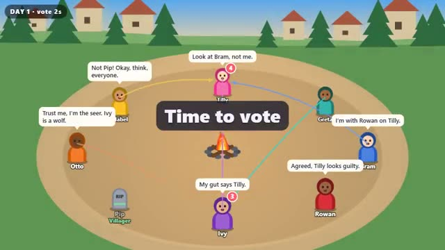

# Werewolf Night

Wolves hunt by night. The village votes by day. A multiplayer starter game from [Multiplayer Agent](https://multiplayeragent.com): 2D, party, 4–10 players, with bots that fill empty seats.

## How it plays

Everyone gets a secret role: werewolf, seer or villager. At night the wolves pick a victim and the seer checks one player; by day the village talks it out and votes someone out, until every wolf is gone or the wolves match the village.

**Controls:** Click or tap a player to act or vote, type to chat.

## Make it yours in the Game Builder

Open the [Game Builder](https://multiplayeragent.com), choose **Start from a starter game** and pick Werewolf Night. It opens as version 1 in your studio, ready to play and publish. Then ask for changes, for example:

- Add a doctor who can save one player each night
- Let the werewolves chat in secret at night
- Set it on a pirate ship with mutineers

## Run it yourself

1. Get a free publishable key (`pk_…`) at [multiplayeragent.com](https://multiplayeragent.com).
2. In `index.html`, put it in place of `pk_REPLACE_ME` in the `MP_CONNECT` block.
3. Open `index.html` in a browser. No build step and no server needed.

Without a key it still runs, offline against bots.

## How it is built

- One `index.html`. The comment at the top of the script maps the code and explains the multiplayer.
- **Hidden info:** Your role is sealed so only you can read it (the host deals, so it can too).
- **Host-run rounds:** The host's browser runs night and day, checks every move and counts the votes; if it leaves, the next player takes over.
- **Bots:** Bots fill the village: they chat, accuse, claim to be the seer and vote. A bot wolf hunts too.
- **Leaderboard:** Games won, by each player.
- `?attract` runs it offline with bots only. The preview video is recorded from it.

## License

MIT.
